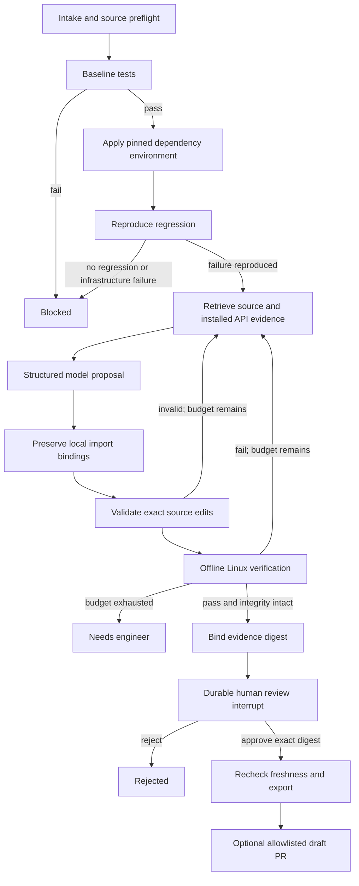

# Agent framework

The graph solves a concrete engineering workflow: produce a reviewable source repair for a reproducibly broken dependency upgrade. The model is a proposer; deterministic code controls execution, edit permissions, verification, retries and delivery.

## Retrieval and model

Source chunks follow function/class boundaries and overlapping line windows, ranked against failure symbols and the dependency name. The final prompt includes small files whole, or at most two separated windows plus a module header for larger files. It bounds source characters and retains neighboring configuration files. An investigation node compares installed baseline and upgraded package documentation, exports and plugin inventories. It freezes that evidence before inference. Retrieval prioritizes direct dependency consumers. A generic normalization node preserves existing local bindings when an export becomes a named import; every resulting edit still passes the exact-anchor guard. This is task-directed code retrieval, not a document question-answering RAG pipeline.

The hosted configuration uses Gemini (`gemini-3.1-pro-preview`), with Anthropic (`claude-sonnet-4-6`) as an explicitly selected alternative. Native structured-output adapters use the same closed repair schema and numbered source ranges. Gemini has an 8,192-token output ceiling; Anthropic 4,096. Retrieved source and API evidence are bounded before either call. Keys stay in environment configuration and never enter prompts or run reports. Ollama `qwen3:4b` remains optional, with an 8K fast context and 12K reasoning context on retries. There is no automatic cross-provider fallback. Provider availability is checked separately from actual repair correctness; only passing tests and unchanged protected files permit approval.

Each failed attempt returns test examples, the previous proposal and guard feedback. Every new proposal edits the original upgraded source rather than accumulating uncontrolled changes. Invalid structured output consumes an attempt. Three attempts are the default; exhaustion produces `needs_engineer`, never fabricated success.

## Guardrails

- Before inference: registered revision/environment, bounded source inventory, obvious credential detection, passing baseline and reproducible failure.
- Before applying: strict JSON schema, valid half-open source ranges, source allowlist, no test edits, traversal/symlink refusal, unique exact anchors, edit budget and detection of newly introduced shell/network/process/test-bypass constructs.
- After applying: non-root offline read-only Linux test container; CPU, RAM, PID, file-size, log and wall-clock limits; nonempty passing test report; same baseline test count; exact upgraded dependency version; unchanged tests/manifests and installed dependency contents.
- Before export: explicit reviewer approval of the evidence digest; recheck source inventory/content, protected files, dependency tree and case definition.
- Before GitHub delivery: approved state, fresh evidence, repository allowlist, current default-branch SHA matching the case, deterministic branch and draft-only PR.

These checks reduce specific risks; they are not a proof that arbitrary hostile code is safe. The worker belongs on a disposable dedicated VM. Source-pattern guards can be evaded by obfuscation; the model cannot grant itself more execution privileges.

## Dataset and evaluation policy

DepBench metadata is pinned at `3eef955c222baa310ef039153755ec9d7cdb03f3`; GitHub source archives are pinned by commit and SHA-256. Four MIT-licensed upstream cases cover js-yaml, Terser, lru-cache and SVGO. Lockfiles are committed under `bootstrap/` for reconstruction. Reference solution files are never downloaded or supplied to the model.

The v8r canonical test additions were used during development and are not held out. The other cases use original upstream tests for repair; separate verifier additions may be run only after a candidate is frozen and must be reported separately. All test environments use a common pinned Linux Node 18 image, an adaptation of the historical benchmark environments. No official DepBench score or broad repair success rate is claimed.

Operator-prepared canonical test migrations are fixed inputs, protected from model edits and included in reviewed exports. LRU runtime tests and `tsd` must both pass. Final artifacts are checked by applying them to pristine pinned source archives; see VALIDATION.md.

Security policy violations stop model processing and record a safe reason in the trace. Dependency documentation is screened before checkpoint persistence; all outbound model evidence and returned proposals are screened. Export rechecks stored edits against the current capability policy. Source/docs/logs cannot grant tools, authority or approval. See SECURITY.md for the heuristic detectors and deterministic execution boundaries.

### Repository intake boundary

`github_connection.py` owns server-side GitHub credentials and fixed read-only MCP dispatch. `onboarding.py` validates manifests, archive paths, test profiles and registry downloads, prepares snapshots without lifecycle scripts, and registers an immutable case. The model cannot select a GitHub tool, credential, endpoint, shell command, or runner profile. Baseline failure stops the graph before repair. Imported cases retain existing bounded edits, isolated verification and digest-bound human approval.
