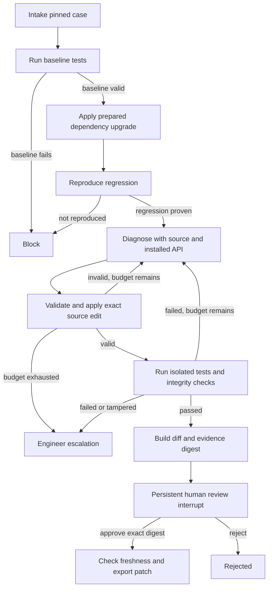

# Agent framework

The graph has actual branching, bounded retries, persistent state and an interrupt. It performs a source change and verifies executable behavior rather than generating an answer from retrieved documents.

## State and durability

State includes the run ID, event history, baseline and regression results, source snapshot, protected-file hash, attempts, model usage, candidate repair, verification results, patch and evidence digest. SQLite checkpoints persist the review interrupt across process restart. Jobs are stored separately with idempotency keys. One worker processes the queue. Restart resumes queued interrupted jobs from checkpoints; each tool must tolerate replay. Full crash-injection coverage is still pending.

## Retrieval and preparation

This pilot uses bounded overlapping source windows (80 lines, stride 60), lexical ranking against failures and dependency references, and at most six chunks. Test files and test helpers are excluded from source context. The installed package's public API is supplied separately. This is **not** AST chunking, embedding retrieval or a trained reranker. Those are not implemented and should be compared against this baseline on harder cases before introduction.

The first development case uses canonical verifier additions to expose a missing YAML regression test. Failure summaries are fed back to the model. Therefore this case is a development case and cannot be counted as an untouched held-out benchmark result. Gold solution files were not accessed. Other dataset tasks are metadata-only until qualified.

## Guardrails

Input: fixed qualified case identifier; no caller-supplied shell commands or repository URLs; credential-free test environment; model treats source as untrusted data.

Pre-execution: strict JSON schema; one atomic source edit per attempt; path allowlist; absolute paths, traversal, test edits, manifest edits, symlinks, nonexistent or ambiguous anchors and no-op edits rejected. Edits are validated before writing.

Execution: isolated copied workspace; network denied; reads restricted to the workspace and runtime directories; source writes denied; only temporary output and the known cache directory writable; process timeout and process-group kill. This macOS harness has not been audited as a hostile multi-tenant sandbox.

Post-execution: nonzero test count; same test count as baseline; all tests pass; installed target version stays 4.0.0; protected files and source remain unchanged during tests. The model cannot self-certify a repair.

Output: diff and verification report are hashed together; review resumes only against that digest; source/protected-file freshness is rechecked at export; artifact is read back. There is no automatic merge, network execution or deployment.

## Failure handling

Bad baseline or absent prepared data blocks the run. Invalid model edits receive bounded feedback. At most two proposal attempts occur. Each attempt restores the original upgraded source. Model/network failures are surfaced rather than replaced by a fabricated patch. Exhausted retries and integrity failures route to engineer escalation.

## Next technical work

Generalize task adapters and dependency evidence beyond js-yaml; validate behavior with held-out cases across ecosystems; add durable per-attempt token accounting and cancellation; bind approvals to complete environment/dependency digests; move execution into independent disposable workers before accepting customer repositories.
